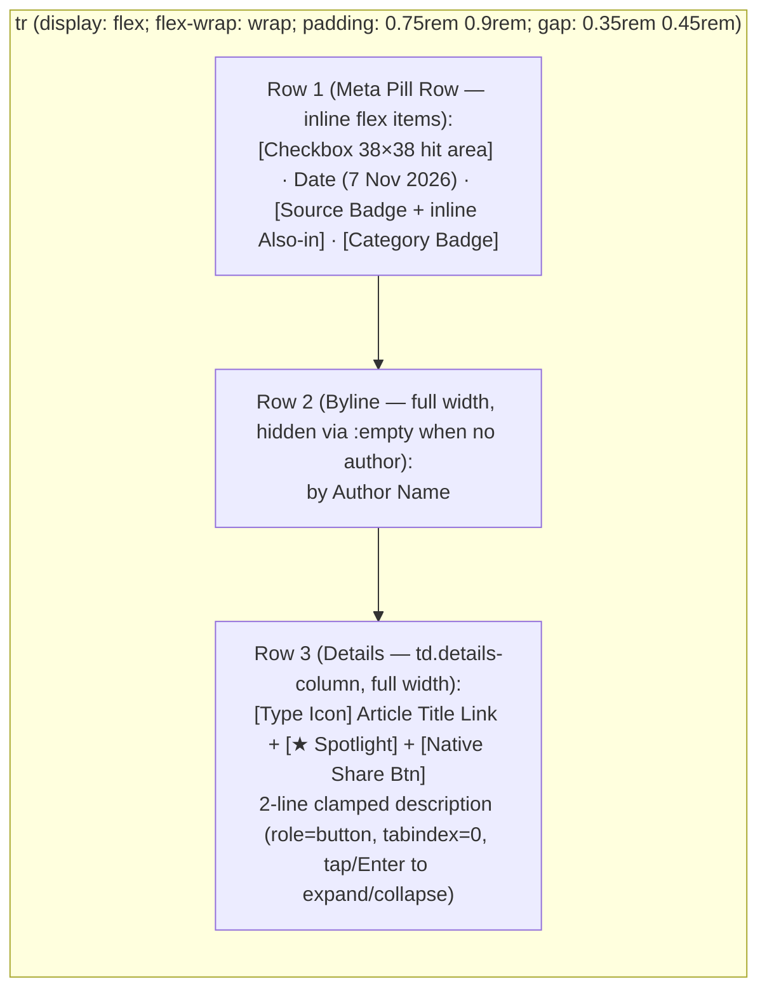

# Implementation Plan: Compact Mobile Feed Card Layout & Standalone PWA Shell

> [!IMPORTANT]
> **Reviewed & Updated**: This plan has been audited against `code/builders/news_template.html`, `code/builders/build_news_page.py`, and `news-icon.svg`. All 4 `Must-Fix` blockers and 8 `Should-Fix` / `Nice-to-Have` UX & accessibility improvements have been incorporated below (see [Section 5](#5-architectural-review-findings--resolutions)).

## 1. Goal & Architectural Constraints

Transform `news.html` (generated from `code/builders/news_template.html` via `code/builders/build_news_page.py`) on mobile viewports (`@media (max-width: 768px)`) from a tall 6-row stacked table-cell layout into a **compact 3-line native-feeling feed reader**, collapse the 500px filter stack behind a **1-tap mobile filter drawer**, and add **OS-native standalone PWA capabilities** (`Add to Home Screen`, safe-area insets, and native share sheet)—all while preserving:
- **Zero changes to desktop (`> 768px`) layout and behavior.**
- **Single self-contained `news.html` artifact** (no external CSS/JS/manifest files required at runtime).
- **Strict accessibility & `modern-web-guidance` compliance** (preserving DOM vs. visual focus order, semantic table headers, `38×38px` touch target sizing, and `prefers-reduced-motion` / `prefers-reduced-transparency`).

---

## 2. Proposed Changes

### Part A: Compact 3-Line Mobile Feed Card (`@media (max-width: 768px)`)

#### Current Problem
In `code/builders/news_template.html` (lines 1760–1825), `@media (max-width: 768px)` sets `table, thead, tbody, th, td, tr { display: block; }` and injects `td::before { content: attr(data-label); display: block; }` on every cell (`SELECT`, `DATE`, `SOURCE`, `CATEGORY`, `AUTHOR`, `DETAILS`).
- Each article card consumes **~280px–340px** of vertical height (~1.3 articles per screen on a `390×844` phone).
- Articles with `author: null` still render an empty `AUTHOR` label block (`td.author-column`).
- `.source-badges` defaults to `flex-direction: column`, vertically stacking `.also-in` pills and inflating row height.
- `tr.selected-row td` applies background tints and left `box-shadow` stripes to individual `td` cells rather than the card container.

#### Proposed Design


1. **Preserve DOM Order = Visual Order (`modern-web-guidance` `css-layout` rule)**:
   - The `<tr>` children in `render()` (lines 2984–3086) are appended in this exact DOM order:
     1. `td.select-col` (Checkbox — interactive, styled with `min-width: 38px; min-height: 38px; display: inline-flex; align-items: center; justify-content: center;` for accessible thumb targets)
     2. `td.date-column` (Date — text)
     3. `td.source-column` (Source badge — interactive link; override `.source-badges` on mobile to `flex-direction: row; flex-wrap: wrap; align-items: center; gap: 0.35rem;` so `.also-in` sits inline)
     4. `td.category-column` (Category badge — text, with `min-width: 0` so narrow `320px–390px` viewports wrap cleanly)
     5. `td.author-column` (Author — text)
     6. `td.details-column` (`data-label="Details"` — add `tdDetails.className = 'details-column';` at line 3067 of `code/builders/news_template.html`)
   - By making `tr` a `display: flex; flex-wrap: wrap; align-items: center; gap: 0.35rem 0.45rem;` container at `@media (max-width: 768px)` **without CSS `order` overrides**:
     - Items 1–4 (`td.select-col`, `td.date-column`, `td.source-column`, `td.category-column`) flow inline on **Row 1 (the Meta Pill Row)**.
     - Item 5 (`td.author-column`) has `flex: 1 1 100%; font-size: 0.78rem; color: var(--text-secondary);` and `td.author-column:empty { display: none; }`, rendering a compact byline (`td.author-column:not(:empty)::before { content: "by "; font-weight: 400; color: var(--text-secondary); text-transform: none; display: inline; }`) only when an author exists.
     - Item 6 (`td.details-column`) has `flex: 1 1 100%; margin-top: 0.1rem;` containing the prominent article title and 2-line clamped synopsis.
   - **Result**: Sequential keyboard/switch-control focus order (`Checkbox` → `Source Issue Link` → `Article Title Link` → `Share Button` → `Expandable Synopsis`) matches visual top-to-bottom, left-to-right order 100%.

2. **Eliminate Redundant `td::before` Block Headers & Fix `.selected-row` / Touch `:hover` on Mobile**:
   - Remove the generic `td::before { content: attr(data-label); display: block; ... }` rule on mobile.
   - Override `tr.selected-row` on `@media (max-width: 768px)` so the card itself (`tr.selected-row`) receives the tinted background (`rgba(56, 189, 248, 0.08)`), border (`rgba(56, 189, 248, 0.35)`), and left accent bar (`box-shadow: inset 3px 0 0 var(--accent-blue)`), while resetting `tr.selected-row td` to `background: transparent !important; box-shadow: none !important;`.
   - Wrap desktop `tr:hover td` in `@media (hover: hover)` to eliminate sticky grey tap flashes on iOS/Android touchscreens.

3. **2-Line Description Clamping with Keyboard-Accessible Tap-to-Expand (`modern-web-guidance` `css-layout` §6)**:
   - Render `.description-text` in `render()` (line 3081) with `role="button" tabindex="0" aria-expanded="false" title="Tap to expand or collapse full synopsis"`.
   - On `@media (max-width: 768px)`, style `.description-text` with:
     ```css
     .description-text {
       display: -webkit-box;
       -webkit-box-orient: vertical;
       -webkit-line-clamp: 2;
       line-clamp: 2;
       overflow: clip;
       font-size: 0.85rem;
       line-height: 1.45;
       margin-top: 0.3rem;
       cursor: pointer;
     }
     .description-text.expanded {
       display: block;
       -webkit-line-clamp: unset;
       line-clamp: unset;
       overflow: visible;
     }
     ```
   - Add delegated click and `keydown` (`Enter` / `Space`) listeners on `#tableBody` so activating `.description-text` on mobile toggles `.expanded` and updates `aria-expanded="true/false"`, while `.hide-descriptions .description-text { display: none !important; }` continues to hide descriptions globally when the `Descriptions` switch is turned off.

4. **Preserve Screen-Reader Table Header Semantics on Mobile**:
   - Replace `thead { display: none; }` at `@media (max-width: 768px)` with accessible `.sr-only` clipping (`position: absolute; width: 1px; height: 1px; clip: rect(0, 0, 0, 0); overflow: hidden;`) so assistive technologies that retain table semantics still announce column headers cleanly.

---

### Part B: Collapsible Mobile Filter Drawer & Compact Toolbar (`@media (max-width: 768px)`)

#### Current Problem
On mobile (`<= 768px`), `.controls-panel` stacks 4 full-width dropdowns (`Timeframe`, `Source`, `Categories`, `Content Type`) plus 3 vertical toggle switches (`Descriptions`, `Spotlights`, `Future Events`) **above** `#tableToolbar`. Users must scroll ~500px past controls on every page load before seeing the first article.

#### Proposed Design
1. **Compact Header & Safe-Area Insets on Mobile**:
   - Set `body` mobile padding to `calc(0.85rem + env(safe-area-inset-top, 0px)) calc(0.75rem + env(safe-area-inset-right, 0px)) calc(1.25rem + env(safe-area-inset-bottom, 0px)) calc(0.75rem + env(safe-area-inset-left, 0px))`.
   - Update `.table-progress-bar` on mobile to `top: env(safe-area-inset-top, 0px);` and `<dialog id="guideDialog">` to respect `env(safe-area-inset-top, 0px)` so neither collides with the iOS notch / Dynamic Island in standalone mode.

2. **Mobile Filter Drawer Toggle Button & Accessible Focus Management**:
   - Add `#mobileFilterToggleBtn` inside `.toolbar-left` (hidden on desktop `> 768px`, visible beside `#searchToolbar` on `<= 768px`):
     ```html
     <button type="button" id="mobileFilterToggleBtn" class="btn-mobile-filters" aria-expanded="false" aria-controls="controlsPanel">
       <svg width="16" height="16" fill="none" viewBox="0 0 24 24" stroke="currentColor" aria-hidden="true">
         <path stroke-linecap="round" stroke-linejoin="round" stroke-width="2" d="M3 4a1 1 0 011-1h16a1 1 0 011 1v2.586a1 1 0 01-.293.707l-6.414 6.414a1 1 0 00-.293.707V17l-4 4v-6.586a1 1 0 00-.293-.707L3.293 7.293A1 1 0 013 6.586V4z" />
       </svg>
       <span>Filters</span>
       <span id="mobileFilterBadge" class="mobile-filter-badge" hidden>0</span>
     </button>
     ```
   - Keep `.controls-panel` (given `id="controlsPanel"`) in its existing DOM position so desktop is 100% untouched.
   - On mobile (`<= 768px`), `.controls-panel` is hidden by default (`display: none`) and revealed when `.mobile-filters-open` is toggled on `controlsPanel`.
   - Include a mobile-only drawer header/footer bar inside `#controlsPanel` with a **`Done` (`#closeMobileFiltersBtn`)** button:
     - Opening `#mobileFilterToggleBtn` sets `aria-expanded="true"` and moves focus to `#timeframeFilterDropdown summary`.
     - Activating `#closeMobileFiltersBtn` or pressing `Escape` inside `#controlsPanel` on mobile collapses the drawer, sets `aria-expanded="false"`, and returns focus to `#mobileFilterToggleBtn`.

3. **Active Filter Count Badge (`#mobileFilterBadge`)**:
   - Compute the count of non-default filter states (`timeframe !== '30'`, partial selections in `Source`/`Categories`/`Content Type`, `Spotlights` on, `Future Events` on, or `Descriptions` off) and display the badge count on `#mobileFilterToggleBtn` whenever `count > 0`.

4. **1-Column Full-Width Dropdowns + Horizontal Switch Row Inside Mobile Drawer**:
   - Keep the 4 `<details class="multi-filter">` dropdowns stacked 1-column full-width (`width: 100%`) inside `.controls-panel` on mobile so their `position: absolute` menus (`left: 0; right: 0; width: 100%;`) never overflow the right edge of the viewport.
   - Arrange the 3 switches (`Descriptions`, `Spotlights`, `Future Events`) in a compact horizontal flex-wrap row (`flex-direction: row; flex-wrap: wrap; gap: 0.65rem 1rem;`).

---

### Part C: OS-Native Standalone PWA Shell & Native Share Sheet

1. **Viewport, Standalone Meta Tags & Raster PNG `apple-touch-icon`**:
   - In `code/builders/news_template.html` (lines 1–15):
     ```html
     <meta name="viewport" content="width=device-width, initial-scale=1.0, viewport-fit=cover">
     <meta name="theme-color" content="#0b0f19">
     <meta name="apple-mobile-web-app-capable" content="yes">
     <meta name="mobile-web-app-capable" content="yes">
     <meta name="apple-mobile-web-app-status-bar-style" content="black-translucent">
     <meta name="apple-mobile-web-app-title" content="News Catch">
     <link rel="apple-touch-icon" href="{{NEWS_ICON_PNG_DATA_URI}}">
     <link rel="manifest" href="{{NEWS_MANIFEST_DATA_URI}}">
     ```
   - In `code/builders/build_news_page.py` (lines 47–56), extract the embedded `data:image/png;base64,...` URI from `news-icon.svg` (falling back to `icon_data_uri` only if not present) and inject it as `{{NEWS_ICON_PNG_DATA_URI}}` so iOS Safari renders a crisp raster Home Screen icon.

2. **Inline Data-URI Web App Manifest (`{{NEWS_MANIFEST_DATA_URI}}`)**:
   - In `code/builders/build_news_page.py` (lines 47–56), generate a base64-encoded `data:application/manifest+json;base64,...` URI containing:
     - `name`: `"News Catch — AI, Architecture & Engineering"`
     - `short_name`: `"News Catch"`
     - `display`: `"standalone"`
     - `background_color`: `"#0b0f19"`
     - `theme_color`: `"#0b0f19"`
     - `icons`: `[{"src": icon_png_data_uri, "sizes": "189x189", "type": "image/png"}, {"src": icon_data_uri, "sizes": "any", "type": "image/svg+xml"}]`
   - **Important**: Omit `start_url` and `scope` from the `data:` manifest JSON so browsers default `start_url` to the host document URL per W3C Web App Manifest §5.2 without throwing `Invalid URL` on opaque `data:` origins.

3. **Mobile Native Share Button (`navigator.share`)**:
   - On each article card's `.article-header-row`, include a subtle mobile share button (`.btn-share-article`, visible on mobile `< 768px`, hidden on desktop `> 768px`) that invokes `navigator.share({ title: article.title, url: article.link })` when supported, or copies `article.link` to the clipboard with a brief visual confirmation (`Copied!`) as fallback.

---

## 3. Files to Modify

- `code/builders/news_template.html`
- `code/builders/build_news_page.py`
- `tests/test_data_integrity.py`
- `docs/NEXT-STEPS.md`

---

## 4. Verification Plan

1. **Automated Test Suite**:
   - Run `python3 code/build.py` and `python3 -m unittest discover -s tests -p "test_data_integrity.py"`.
   - Add unit test assertions in `tests/test_data_integrity.py` verifying PWA meta tags, PNG `apple-touch-icon` data URI, valid base64 Web App Manifest without relative `start_url`, `#mobileFilterToggleBtn`, and `.details-column` markup.
2. **Responsive & Accessibility Verification**:
   - Confirm desktop (`1280×800`) layout and behavior remain unchanged.
   - Confirm mobile (`390×844` and `320×568`) card compactness, collapsible filter drawer + badge count, safe-area insets, `.selected-row` card styling, and keyboard/touch expandability of 2-line descriptions.

---

## 5. Architectural Review Findings & Resolutions

| # | Severity | Reviewer Finding | Resolution in Plan |
| :--- | :--- | :--- | :--- |
| 1 | **Must-Fix** | `tdDetails` in `render()` lacked `.details-column` class, so `td.details-column` CSS would not match. | Added `tdDetails.className = 'details-column';` in `render()` (Part A §1). |
| 2 | **Must-Fix** | iOS Safari ignores `data:image/svg+xml` for `<link rel="apple-touch-icon">`; requires raster PNG. | Extract embedded `data:image/png;base64,...` from `news-icon.svg` in `build_news_page.py` as `{{NEWS_ICON_PNG_DATA_URI}}` (Part C §1). |
| 3 | **Must-Fix** | Relative `start_url` inside `data:application/manifest+json` throws `TypeError: Invalid URL` due to opaque origin. | Omit `start_url` and `scope` per W3C Manifest §5.2 so browsers default to the document URL (Part C §2). |
| 4 | **Must-Fix** | 2×2 grid on `.controls-panel` causes right-column `320px` `.multi-filter-menu` popovers to overflow the viewport. | Keep 4 dropdowns 1-column full-width inside the collapsed drawer; only horizontalize the 3 toggle switches (Part B §4). |
| 5 | **Should-Fix** | Opening `.controls-panel` from `#tableToolbar` needs keyboard focus routing so `Tab` enters the revealed filters. | Move focus to `#timeframeFilterDropdown summary` on open, and add `#closeMobileFiltersBtn` (`Done`) + `Escape` handler returning focus to `#mobileFilterToggleBtn` (Part B §2). |
| 6 | **Should-Fix** | Desktop `tr.selected-row td` tints individual pills instead of the mobile card container. | Style `tr.selected-row` directly on mobile and reset `tr.selected-row td` backgrounds/shadows (Part A §2). |
| 7 | **Should-Fix** | `thead { display: none; }` removes column header labels from screen readers. | Replace with `.sr-only` clip rect on mobile (Part A §4). |
| 8 | **Should-Fix** | `.table-progress-bar` (`top: 0`) and `#guideDialog` collide with iOS notch under `black-translucent` status bar. | Use `env(safe-area-inset-top, 0px)` on `.table-progress-bar` and `#guideDialog` (Part B §1). |
| 9 | **Should-Fix** | `.source-badges` has `flex-direction: column` on desktop, vertically stacking `.also-in` on mobile Row 1. | Override `.source-badges` to `flex-direction: row; flex-wrap: wrap; align-items: center;` on mobile (Part A §1). |
| 10 | **Nice-to-Have** | `.description-text` tap-to-expand lacked keyboard semantics and state. | Added `role="button"`, `tabindex="0"`, `aria-expanded="false"`, and `Enter`/`Space` handling (Part A §3). |
| 11 | **Nice-to-Have** | `tr:hover td` causes sticky hover flashes on touch devices. | Wrapped `tr:hover td` in `@media (hover: hover)` (Part A §2). |
| 12 | **Nice-to-Have** | Removing padding on `td.select-col` shrinks checkbox tap target below 38px. | Enforced `min-width: 38px; min-height: 38px; display: inline-flex;` on `td.select-col` on mobile (Part A §1). |
